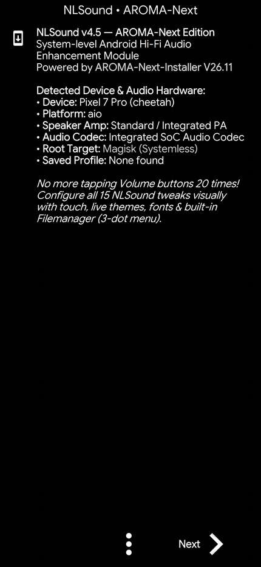
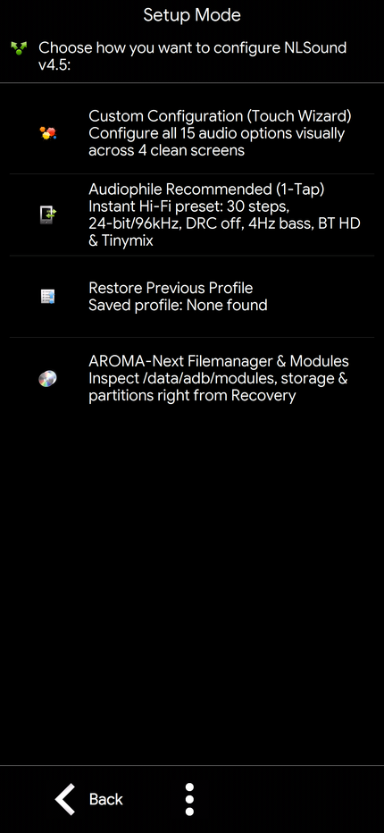
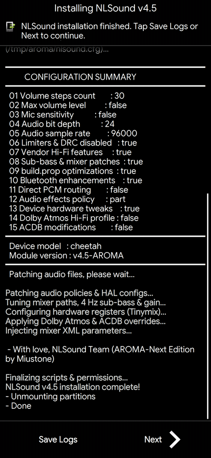
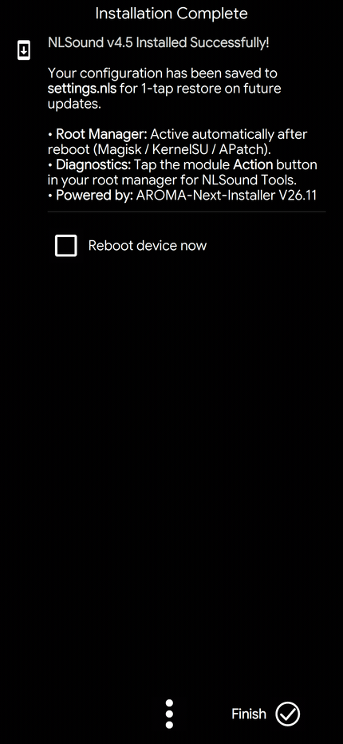

<div align="center">

[ **English** ] • [ [Русский](README_RU.md) ] • [ [繁體中文](README_ZH.md) ]

# 🎵 NLSound — AROMA-Next Edition

### System-level Android Hi-Fi Audio Enhancement Module with Material 3 Touch GUI in Recovery (Powered by [AROMA-Next-Installer (`ANI`) V26.11-RC5](https://github.com/Miustone/AROMA-Next-Installer))

[](https://github.com/Miustone/AROMA-Next-Installer)
[](https://github.com/Briclyaz/NLSound)
[](https://github.com/Briclyaz/NLSound)
[](https://github.com/Miustone/AROMA-Next-Installer)
[](https://github.com/Briclyaz/NLSound)

[Screenshots](#-screenshots-recovery-touch-gui) • [Why AROMA-Next](#-why-this-fork--one-aroma-config-zero-mmt-extended) • [Features](#-key-features-at-a-glance) • [Changelog](CHANGELOG.md) • [AROMA-Next-Installer](https://github.com/Miustone/AROMA-Next-Installer)

</div>

---

## 📸 Screenshots (Recovery Touch GUI)

<p align="center">
  <em>Captured live on Google Pixel 7 Pro (<code>cheetah</code>) • OrangeFox R12.0 • Black &amp; White Theme + Google Sans — Click any screenshot for full QHD+ resolution</em>
</p>

<div align="center">
  <table>
    <tr>
      <td align="center">
        <a href="screenshots/01-welcome-dashboard.png">
          
        </a><br>
        <sub><b>1. Welcome &amp; Hardware Dashboard</b></sub>
      </td>
      <td align="center">
        <a href="screenshots/02-setup-mode.png">
          
        </a><br>
        <sub><b>2. Setup Mode Hub</b></sub>
      </td>
      <td align="center">
        <a href="screenshots/03-live-install-log.png">
          
        </a><br>
        <sub><b>3. Live Install &amp; Summary Log</b></sub>
      </td>
      <td align="center">
        <a href="screenshots/04-install-complete.png">
          
        </a><br>
        <sub><b>4. Complete &amp; 1-Tap Reboot</b></sub>
      </td>
    </tr>
  </table>
</div>

---

## ✨ Why This Fork? — ONE `aroma-config`, ZERO MMT-Extended!

Upstream **NLSound** relies on MMT-Extended + a 200-line bash Volume Key Selector with **15 sequential prompts**.

With **[AROMA-Next-Installer](https://github.com/Miustone/AROMA-Next-Installer)**'s built-in **Dual-Mode Engine**, module developers author **only ONE `aroma-config`** (zero MMT-Extended, zero duplicate Volume Key code!) and automatically get both worlds:

| Environment | Installer Experience | Highlights |
| :--- | :--- | :--- |
| **Custom Recovery** (`TWRP`, `OrangeFox`, `AERA`, `PitchBlack` — `BOOTMODE=0`) | **🎨 `ANI` V26.11-RC5 Material 3 Touch GUI** | **AMOLED Modern** Material 3 You default theme (**Monochrome White** default + **8 Live Accents**), **17 redesigned Material 3 icons**, punch-hole-safe **Top Status Bar**, 1-tap stay-open **Appearance Bottom Sheet**, lossless **PNG screenshots**, live SmartPA/DAC dashboard, **1-Tap Audiophile Preset**, **1-Tap Profile Restore**, all 15 options across **4 touch screens**, and integrated **AROMA-Next-Filemanager (`ANF`)** with 1-tap **Bootloop-Saver**! |
| **Booted Android** (`Magisk`, `KernelSU`, `APatch` App — `BOOTMODE=1`) | **⌨️ Built-In `ANI` Volume Key Selector** | Automatically renders the **exact same `aroma-config`** (`menubox`, `form`, `checkbox`, `selectbox`, `viewbox`) via native C `/dev/input` Volume Keys with **Go Back navigation** (`<- Go Back` / `VOL-` long-press) and `--preset` replay — zero duplicate code! |
| **Locked Recovery Display** (`EXIT 77` Safety) | **🛡️ Automatic Volume Key Fallback** | Never freezes recovery — switches automatically to `ANI`'s native Volume Key Selector from the same `aroma-config`. |

> [!TIP]
> **Shared Profile Compatibility (`settings.nls`):** Profiles created in Recovery via **AROMA-Next** and profiles created inside **Magisk / KernelSU / APatch** share the exact same `/data/adb/modules/NLSound/settings.nls` format for instant 1-tap restore across updates.

### ✨ Zero-Bloat CI Magic (`Miustone/aroma-next-action@v1`) & Building
Look inside `META-INF/com/google/android/` — **279 vendored `ANI` binaries, themes, fonts, and icons are completely gone from Git!** Only NLSound's own 5 installer files (`aroma-config`, custom `magisk-installer`, `updater-script`, `nlsound-probe.sh`, `nlsound-summary.sh`) live in this repo.

```text
  NLSound Repo (Audio Payload + 5 Installer Files)   Miustone/AROMA-Next-Installer (Release)
  ├─ common/ + system/ + customize.sh                ├─ arm64-v8a & armeabi-v7a ANI+ANF binaries
  ├─ META-INF/.../aroma-config + nlsound-*.sh        ├─ AMOLED Modern + 7 Classic Themes
  └─ META-INF/.../magisk-installer (custom override) ├─ 17 Material 3 Icons + 7 SIL OFL Fonts
                         │                           └─ update-binary & aroma-mod-lib.sh
                         └─────────────┬─────────────┘
                                       ▼
                  [ Miustone/aroma-next-action@v1 (template: magisk) ]
                   Overlays NLSound files on top — custom overrides always win!
                                       │
                                       ▼
             dist/NLSound-v4.5-AROMA-RC5-Next.zip  (297 entries, Recovery & App ready!)
```

- **Automatic CI Releases:** [`.github/workflows/release.yml`](.github/workflows/release.yml) uses **[`Miustone/aroma-next-action@v1`](https://github.com/Miustone/aroma-next-action)** to fetch the latest official `ANI` + `ANF` release on every build, overlay NLSound's payload & custom `magisk-installer` (`settings.nls` preservation) on top, verify permissions/LF/`sh -n`, and publish the ready-to-flash ZIP automatically.
- **Local Build:**
  ```sh
  # Auto-fetches & caches ANI Magisk Template into .aroma-cache/ (or pass --aroma-zip <path> offline)
  python build.py
  ```
  Outputs `dist/NLSound-v4.5-AROMA-RC5-Next.zip` with proper Unix `0755` permissions and LF line endings, ready to flash in Recovery or any Root Manager app.

---

---

## ❓ What is NLSound and why do you need it?

By default, stock Android treats your audio hardware very conservatively. To prevent cheap built-in speakers from rattling, Android heavily **compresses audio dynamics**, **cuts deep sub-bass frequencies**, enforces **coarse 15-step volume sliders**, and limits Bluetooth bitrate.

**NLSound** is an all-in-one system audio module for rooted Android devices. It safely removes software limiters, tunes low-level hardware registers, and unlocks the true capabilities of your phone's DAC, speaker amplifiers, and microphones.

> [!NOTE]
> **No background apps or battery drain:** NLSound modifies system configurations and driver registers directly. Once installed, it works completely in the background without needing companion apps or persistent background services.

---

## ⚡ Why NLSound? (Comparison)

| Feature | Stock Android 📱 | With NLSound 🎵 |
| :--- | :--- | :--- |
| **Volume Slider** | Coarse 15 steps (abrupt jumps) | **30, 50, or 100 smooth steps** |
| **Sub-Bass Extension** | Cut off below 25–40 Hz | **Full extension down to 4 Hz** |
| **Audio Dynamics (DRC)**| Compressed & volume ducking | **Uncompressed, punchy dynamics** |
| **Low Battery Audio** | Throttled volume below 20% | **Zero throttling or degradation** |
| **Bluetooth SBC** | Limited to standard bitrate | **SBC HD Dual Channel unlocked** |
| **Bluetooth Volume** | Buggy / quiet on some buds | **Absolute Volume disabled (Full gain)** |
| **Direct Playback** | Forced AudioFlinger mix | **Bit-perfect Direct PCM mode** |
| **Dolby Atmos** | Volume pumping & hollow sound | **Clean, linear acoustic profile** |

---

## 🏗️ Audio Signal Architecture

```text
[ Audio Players (Poweramp / UAPP / Apple Music / Spotify) ]
                           │
                           ▼
             ┌───────────────────────────┐
             │   Android AudioFlinger    │ ──► [BYPASSED via DIRECT_PCM]
             │  (Forced Resampling/Mix)  │
             └───────────────────────────┘
                           │
                           ▼
             ┌───────────────────────────┐
             │   DSP & Sound Limiters    │ ──► [DRC / HPF 25Hz Limiters REMOVED]
             └───────────────────────────┘
                           │
                           ▼
             ┌───────────────────────────┐
             │   Hardware DAC & SmartPA  │ ──► [4Hz Sub-bass & Hi-Fi Power Mode]
             └───────────────────────────┘
                           │
                           ▼
              🎧 Wired / 🔊 Speakers / 📶 BT HD
```

---

## 🚀 Key Features at a Glance

### 🎚️ 1. Smooth Volume & Hardware Gain
* **More Volume Steps:** Increases the media volume slider from the stock 15 steps to **30, 50, or 100 steps** for precise, smooth control.
* **Independent Preamp Boost:** Fine-tune the hardware digital output level for speakers and wired headphones without affecting Bluetooth audio.
* **Microphone Sensitivity:** Adjust digital recording gain (DEC) to boost quiet voices or prevent clipping in noisy environments.

### 🎧 2. True Hi-Fi & Sub-Bass Restoration
* **Sub-bass Unlocked (4 Hz):** Lowers the built-in headphone High-Pass Filter (HPF) cutoff from ~25 Hz down to **4 Hz**, restoring deep, physical sub-bass in wired headphones.
* **Direct PCM Routing:** Unlocks `DIRECT_PCM` flags, allowing supported players (Poweramp, UAPP, Neutron) to send untouched audio straight to the DAC, bypassing the Android OS mixer.
* **Custom Bit Depth & Sample Rate:** Configure system-wide PCM targets (up to 24/32-bit and 96/192/384 kHz) without forced downsampling.

### 🔇 3. Dynamic Limiters & DRC Removal
* **Disable Audio Throttling:** Removes Dynamic Range Compression (DRC) and artificial low-battery volume throttling.
* **Softclip & Compander Off:** Disables aggressive volume compression that flattens dynamic range during intense music passages.

### 📶 4. Enhanced Wireless (Bluetooth) Audio
* **SBC HD Dual Channel:** Unlocks high-bitrate playback for the universal SBC codec.
* **aptX Adaptive Enhancements:** Enables advanced aptX Adaptive 2.1/2.2 and Lossless LE profiles.
* **Fix Quiet Headphones:** Disables Android's buggy Absolute Volume feature, fixing low-volume issues on wireless headphones.

### 🎛️ 5. Clean Effects & Dolby Atmos Tuning
* **Effects Cleanup:** Disables fake spatializers, phase delays, and synthetic reverbs while preserving your favorite graphic equalizers and call audio clarity.
* **Dolby Atmos DAX Tuning:** Removes the hollow "audio in a bucket" effect, turns off annoying volume pumping, and flattens dialogue compression.

### 📱 6. Model-Specific Hardware Register Presets
* Automatically identifies onboard hardware (Cirrus Logic, Texas Instruments TAS, NXP TFA, Awinic, Qualcomm WSA/WCD).
* Pre-configured, device-tailored ALSA mixer parameters (`tinymix`) for popular Xiaomi, OnePlus, Realme, Samsung, Sony, and Google Pixel smartphones.

---

## 📱 Hardware & Device Support

<details>
<summary><b>Click to view supported devices with dedicated hardware presets</b></summary>
<br>

* **Xiaomi / POCO / Redmi:** 
  * Xiaomi 14 Ultra (`aurora`), Xiaomi 13 Ultra (`ishtar`), Xiaomi 11 Ultra (`star`), Xiaomi 10 Pro (`cmi`), Mi 10 (`umi`);
  * POCO F5 / Redmi Note 12 Turbo (`marble`), POCO F3 / Redmi K40 (`alioth`), POCO X3 Pro (`vayu`), POCO X3 NFC (`surya`), POCO M3 / Redmi 9T (`citrus`, `juice`, `chime`, `lime`);
  * Redmi Note 10 Pro (`sweet`, `mojito`), Redmi Note 9 Pro (`joyeuse`, `curtana`, `gram`, `excalibur`).
* **OnePlus:** 
  * OnePlus 13 (`OP5D55L1`), OnePlus 12 (`OP595DL1`), OnePlus 12R / Ace 2 Pro (`OP5D3BL1`, `OP5D2BL1`), OnePlus Ace 3 (`OP5929L1`);
  * OnePlus 9R, OnePlus 9 Pro (`ingres`), OnePlus 7 / 7T / 7 Pro series (`guacamole`, `hotdog`).
* **Realme:** 
  * Realme 12 Pro+ (`RE5C82L1`, `RE5C3B`), Realme GT Neo 5 (`RE5C4FL1`), Realme GT Neo / GT 2 (`RE5473`, `RE879AL1`, `kona`).
* **Google Pixel:** 
  * Pixel 8 and Pixel 8 Pro (`shiba`, `husky`);
  * Pixel 7 Pro with hardware DSP bypass (`cheetah`);
  * Pixel 6, Pixel 6 Pro, Pixel 6a, Pixel 7 (`bluejay`, `oriole`, `raven`, `panther`).
* **Samsung & Sony:** 
  * Samsung Galaxy S22 Ultra (`b0q`);
  * Sony Xperia 1 II (`XQ-AT52`), Sony Xperia 5 IV (`XQ-CQ62`).
* *Devices not listed receive universal adaptive tuning based on detected audio amplifier chips.*

</details>

<details>
<summary><b>Detected Audio Amplifiers & DAC Hardware</b></summary>
<br>

NLSound scans hardware bus interfaces (`I2C`, `SoundWire`, `Slimbus`, `Platform`) to automatically tune:
* **Speaker Amplifiers:** Cirrus Logic (CS35L41), Texas Instruments (TAS25xx), NXP / Goodix (TFA98xx), Awinic (AW88xx), Maxim Integrated (MAX98373), Qualcomm WSA (WSA88xx).
* **Primary Audio Codecs / DACs:** Qualcomm WCD (Aqstic / Bolero Hi-Fi), ESS Sabre, Asahi Kasei (AKM).

</details>

---

## 🛠️ Step-by-Step Interactive Installer

When flashing NLSound in your root manager, an interactive terminal menu lets you choose exactly what you want using your **Volume Buttons**:

<div align="center">
<table>
<tr>
<td>
<b>&nbsp;&nbsp;🔴&nbsp;&nbsp;🟡&nbsp;&nbsp;🟢&nbsp;&nbsp;&nbsp;&nbsp;terminal — nlsound-installer</b>
<hr>
<pre>
━━━━━━━━━━━━━━━━━━━━━━━━━━━━━━━━━━━━━━━
 [01/15] VOLUME CONTROL STEPS
━━━━━━━━━━━━━━━━━━━━━━━━━━━━━━━━━━━━━━━
 Changes the number of steps on the media
 volume slider (stock Android has only 15).

 [*] 30 or 50 is recommended for balanced control.

  [VOL+] Next item   ┃   [VOL-] Select

 1. Skip      • Default (15 steps)
 2. 30 steps  • [Recommended] Balanced
 3. 50 steps  • Smooth control
 4. 100 steps • Fine-grained control
</pre>
</td>
</tr>
</table>
</div>

* **[VOL+]** — Move down the list / Confirm installation.
* **[VOL-]** — Select highlighted option / Skip step.

> [!TIP]
> **1-Click Profile Restore:** When updating the module, press **[VOL+]** at the first prompt to automatically restore your previous configuration in seconds!

---

## 📋 Compatibility & Requirements

> [!IMPORTANT]
> Root access (via Magisk v24+, KernelSU, or APatch) is strictly required to modify low-level audio HAL policies and driver registers.

* **Root Solution:** [Magisk](https://github.com/topjohnwu/Magisk) (v24+), [KernelSU](https://github.com/tiann/KernelSU), or [APatch](https://github.com/bmax121/APatch).
* **Overlay Architecture:** Fully compatible with Magic Mount, **KernelSU OverlayFS**, and **Mountify**.
* **Audio Mods:** 100% compatible with Audio Modification Library (AML), ViPER4Android, and JamesDSP.
* **Processors:**
  * **Qualcomm Snapdragon:** Comprehensive support (Snapdragon 625 up to 8 Elite).
  * **MediaTek:** Preliminary support for Dimensity and Helio platforms.
* **Android Versions:** Android 9.0 up to Android 15+.

---

## 📥 Installation

1. Download the latest release `.zip` from [Releases](https://github.com/Briclyaz/NLSound_module_QCom/releases) or our [Telegram Channel](https://t.me/nlsound_updates).
2. Open **Magisk**, **KernelSU**, or **APatch** app.
3. Go to the **Modules** section and select **Install from storage**.
4. Select the downloaded `.zip` file.
5. Follow the on-screen prompts using your **Volume Keys**.
6. Reboot your device after the installation finishes.

---

## ⭐ Star History

<div align="center">

<a href="https://star-history.com/#Briclyaz/NLSound_module_QCom&Date">
  <picture>
    <source media="(prefers-color-scheme: dark)" srcset="https://api.star-history.com/svg?repos=Briclyaz/NLSound_module_QCom&type=Date&theme=dark" />
    <source media="(prefers-color-scheme: light)" srcset="https://api.star-history.com/svg?repos=Briclyaz/NLSound_module_QCom&type=Date" />
    
  </picture>
</a>

<br><br>

[](https://github.com/Briclyaz/NLSound_module_QCom/stargazers)

*If you appreciate the sound improvements, please support the project with a star!*

</div>

---

## 💬 Support & Community

Have questions, suggestions, or want to report a bug?
* 📢 **Announcements & Updates:** [@nlsound_updates](https://t.me/nlsound_updates)
* 💬 **Community Support Chat:** [@nlsound_support](https://t.me/nlsound_support)

---

<div align="center">

**Made with ❤️ by the NLSound Team**

*Non-commercial, open-source project. No ads, no tracking, no paid paywalls.*

</div>
